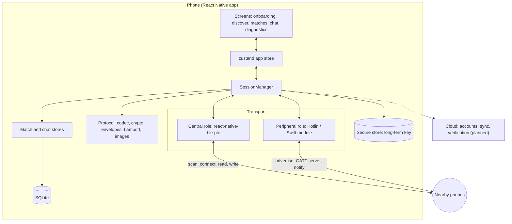
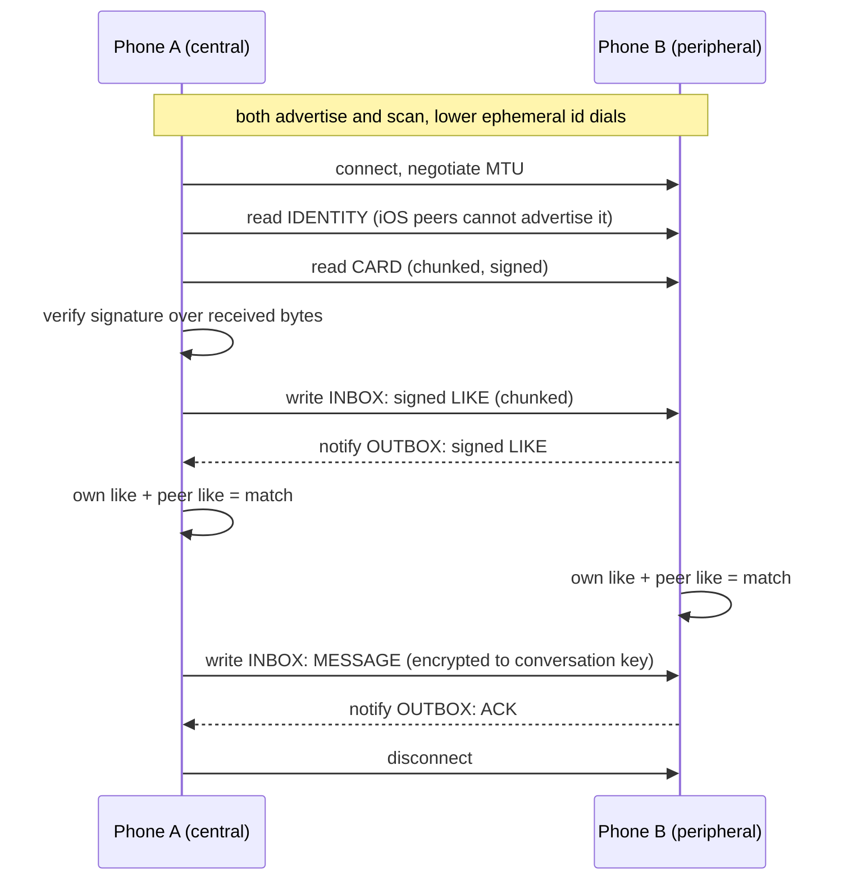
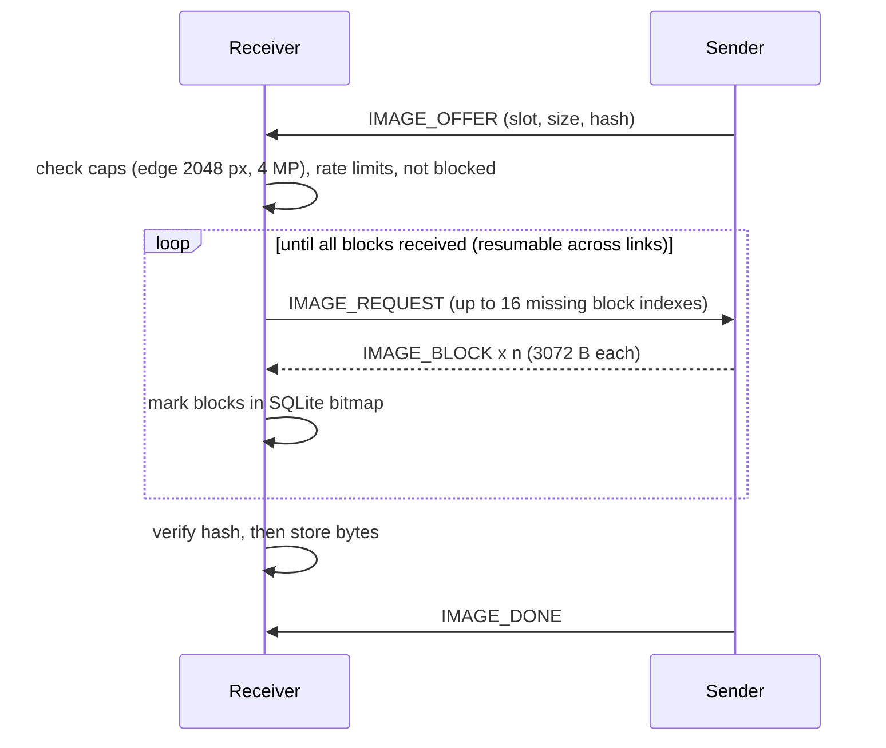
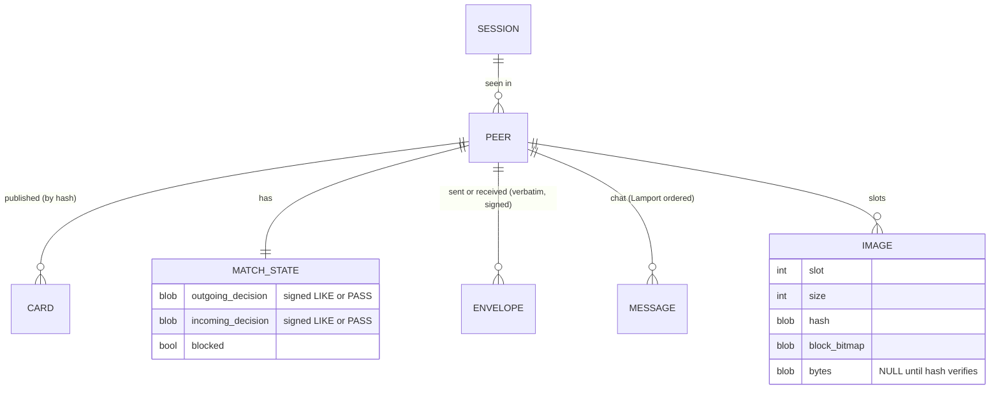
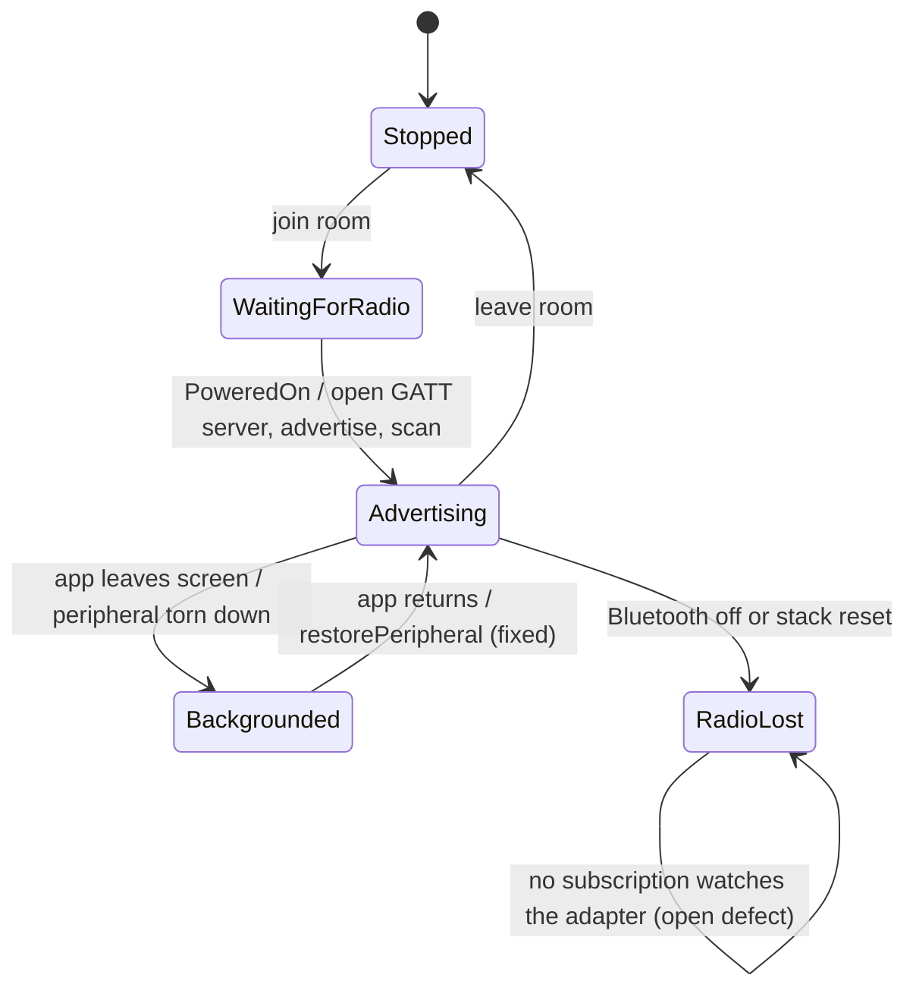

## Overview

Picture a few hundred people on a long flight, a train, a conference floor or a campsite. They are physically close and have no internet. Bluetooth Low Energy reaches tens of metres with no infrastructure, so a social or matching app could work entirely device to device: show a small profile card, like or pass, and chat if both sides liked.

This app is that idea built for real phones. Everyone in a room joins with a short room code. Phones advertise and scan at the same time, connect briefly to read each other's signed card, exchange signed likes, and each phone decides on its own that a match happened. Matched pairs chat end-to-end encrypted over the same short links. Nothing leaves the room; there is no server.

The original concept has three phases: sign up online before the trip, discover and chat over Bluetooth only during it, and sync afterwards. Only the middle phase exists in code, and this page is about that phase. It is **in progress**: the protocol and in-room flow are built and tested, real radios have exchanged data, and the remaining work is radio-lifecycle robustness and the cloud half.

## Problem Statement

### The problem

Social apps assume a server: accounts, matching, message relay and moderation all live in a backend. Without internet, all of that disappears. The people are still there, but the app is useless exactly where meeting strangers is most natural.

### Why it matters

Offline-first social interaction is a hard distributed-systems problem in a small package. There is no clock you can trust (phones in airplane mode drift), no server to arbitrate who liked whom first, no central place to verify identity or handle abuse, and the transport is a lossy, short-range radio with small packets, platform quirks and an operating system that kills background work.

### Who has it

Travellers on long flights and trains, attendees at conferences and festivals with overloaded networks, people at campsites or remote events. More generally, anyone in a crowd with no reliable connectivity.

### Limits of existing options

- **Online dating and social apps** require internet for everything, including showing a profile.
- **AirDrop and Nearby Share** move files between people who already decided to share; they do not do discovery, consent or matching.
- **Mesh chat apps** relay messages across a crowd but are built for broadcast or group chat, not mutual consent before contact.
- **Classic Bluetooth pairing** needs user interaction per device and does not scale to a room.

### Goals and requirements

| Goal | Requirement |
|---|---|
| Works with no network | Discovery, cards, likes, matching and chat over BLE only |
| No server in the room | A match is concluded independently by both phones from two signed likes |
| Consent before contact | Chat opens only after a mutual like; blocking is local and final |
| Tamper evidence | Every decision is a signed envelope verified over the exact received bytes |
| Privacy between sessions | On-air identity changes per session so an observer cannot link sessions |
| Cross-platform | Android and iOS phones interoperate |
| Testable | Protocol, matching and storage tested without a radio |

## Proposed Solution

### Approach

Every phone is both a BLE **central** (scans and connects) and a **peripheral** (advertises and serves a GATT service). Links are short-lived: connect, exchange what is pending, disconnect, with at most three or four links at once. To avoid two phones dialling each other simultaneously, the one with the lower ephemeral id takes the central role.

On top of the radio sits a small protocol: a profile card (up to 512 bytes, signed) is readable from the GATT service, and everything else travels as **signed, chunked MessagePack envelopes** written to the peer's inbox or notified from our outbox. Likes and passes are signed decisions. When a phone holds both its own like and the peer's signed like, it records a match locally. Chat messages are encrypted to a per-conversation key and ordered by a Lamport counter.

### How it answers each requirement

- **No network:** discovery, card exchange, decisions and chat are all GATT reads, writes and notifications.
- **No server:** matching is a pure function over two signed likes held by each phone.
- **Consent:** message envelopes are only accepted from matched peers; blocking stops all exchange and is terminal.
- **Tamper evidence:** signatures are verified over the received bytes before decoding; malformed input returns false instead of throwing.
- **Privacy:** an ephemeral key per session is derived from the long-term key with the session id as salt.
- **Cross-platform:** one TypeScript binding fronts a Kotlin and a Swift peripheral implementation with the same UUID tables, checked by a test.
- **Testable:** the protocol directory has zero React Native or Expo imports, enforced by a test; a WebSocket relay transport and a headless peer CLI let full sessions run on a laptop.

### Key features

- Join a room with a short code; see nearby people as cards with a ThumbHash placeholder and an avatar pulled on request.
- Like or pass; matches appear on both phones without a server.
- End-to-end encrypted chat with delivery acknowledgements.
- Up to two display photos per profile, transferred block by block and resumable across links.
- Go invisible, local block, and a diagnostics screen with a tagged BLE trace.

### Technical decisions and trade-offs

| Decision | Why | Trade-off | Alternative considered |
|---|---|---|---|
| Expo with a dev client | Owner knew JavaScript; native code still possible as an Expo module | Native modules to maintain for two platforms | iOS-native Swift (the first plan); bare React Native |
| ble-plx for central, custom native for peripheral | ble-plx cannot advertise or host a GATT server | Two native implementations | A full native BLE stack per platform |
| Brief connections, 3–4 at once | Phones limit concurrent links; short links survive movement better | Reconnect cost for every exchange | Persistent links per peer |
| Lamport counter, sender key as tiebreak | Airplane-mode clocks are not synchronized | No wall-clock times in chat order | Device timestamps |
| Verify signature before decode | Malformed or hostile bytes never reach the decoder | Must keep exact received bytes | Decode, then verify a re-encoding |
| MessagePack with a 4-byte chunk header | Compact over a small ATT payload | Custom framing to test | JSON; protobuf |
| noble crypto libraries in JavaScript | Same code in tests and on device | Slower than native crypto | Native crypto bindings |
| Raw SQL migrations on expo-sqlite | Small schema, full control | Hand-written migrations | Drizzle (planned in an early README, never adopted) |
| Evidence stored verbatim, never deleted | Foundation for offline abuse reports | Storage grows per session | Discard envelopes after processing |

## Architecture

### High-level design

Each phone is a full node: UI, session logic, protocol, storage and both BLE roles. The diagram shows one phone in detail and its peers; the dashed cloud is the planned post-session half that does not exist yet.



For development the transport is a seam: under Node a WebSocket relay transport and a headless peer CLI replace the radio, so whole sessions (cards, likes, matches, chat, images) run on a laptop. Under Metro, the BLE transport is added behind a runtime toggle.

### Low-level design

**GATT service.** One service carries four characteristics. UUIDs are not secrets, but only roles are shown here.

| Characteristic | Property | Role |
|---|---|---|
| IDENTITY | read | Ephemeral public key, for peers whose advertisement cannot carry it |
| CARD | read, chunked | Signed profile card, up to 512 bytes |
| INBOX | write with response, chunked | Peer to us: envelopes |
| OUTBOX | notify | Us to peer: envelopes |

**Envelope kinds.**

| Kind | Purpose |
|---|---|
| LIKE, PASS | The two signed decisions |
| MESSAGE, ACK | Encrypted chat and delivery confirmation |
| IMAGE_OFFER, IMAGE_REQUEST, IMAGE_BLOCK, IMAGE_DONE | Pull-based photo transfer |

**Discovery to match.** Read the sequence top to bottom: both phones read each other's identity and card, each writes a signed like into the other's inbox, and each concludes the match locally. No message says "you matched".



**Advertising asymmetry.** Android puts an 8-byte ephemeral id in the advertisement's service data (in the scan response, because the 31-byte legacy advertisement overflows). iOS Core Bluetooth can only advertise a local name and service UUIDs, so iOS peers are identified after connecting by reading IDENTITY. That costs one read per new iOS peer.

**Chunking.** Each chunk carries a 4-byte header: a 16-bit message id, an 8-bit sequence number and an 8-bit flags byte with a last-chunk flag. Recently completed ids are suppressed so a late chunk from an old message cannot be glued onto a new one.

```ts
// title: chunk framing, simplified (illustrative, not the project's code)
const HEADER = 4;
export function chunk(msgId: number, bytes: Uint8Array, mtu: number): Uint8Array[] {
  const room = mtu - 3 - HEADER;              // ATT overhead, then our header
  const count = Math.ceil(bytes.length / room);
  if (count > 256) throw new Error("message too large");
  return Array.from({ length: count }, (_, seq) => {
    const out = new Uint8Array(HEADER + Math.min(room, bytes.length - seq * room));
    out[0] = msgId >> 8; out[1] = msgId & 0xff; // u16 big-endian
    out[2] = seq;
    out[3] = seq === count - 1 ? 1 : 0;         // last-chunk flag
    out.set(bytes.subarray(seq * room, (seq + 1) * room), HEADER);
    return out;
  });
}
```

**Size budgets.** These are protocol constants from the code, not performance results.

| Constant | Value | Why |
|---|---|---|
| Card | 512 B | Maximum ATT attribute size |
| Envelope | 4096 B | Caps reassembly memory |
| Reassembled message | 64 KB | Codec-level cap |
| Image block | 3072 B | A few chunks at the iOS MTU |
| Thumbnail | 16 KB max | Per-thumbnail ceiling |
| Display image | 300 KB max | Per-image ceiling |
| Blocks per request | 16 | Bounds one pull |
| Negotiated MTU | 185 on iOS (measured), 517 requested on Android | Platform limits |

**Image transfer.** Images are pulled, never pushed. A card carries a ThumbHash (a few bytes rendered as a blurred placeholder); the avatar thumbnail and up to two display images are offered and then requested block by block. The receiver persists a bitmap of received blocks in SQLite, so a transfer resumes on the next link, and keeps bytes NULL until the hash verifies.



**Storage.** SQLite with a `PRAGMA user_version` ladder: v1 for core tables, v2 for images. Cards are content-addressed by hash; envelopes are stored verbatim with signatures.



**Peripheral lifecycle.** The most damaging bug lived here (see Issues & Fixes): leaving the app tore the peripheral down with no path back.



## Implementation

### Technology stack

Expo and React Native in TypeScript, expo-router, zustand for app state, react-native-ble-plx for the central role, a custom Expo module with Kotlin (Android advertiser and GATT server) and Swift (iOS peripheral server) behind one TypeScript binding, expo-sqlite with raw migrations, the platform secure store for the long-term key, and the noble libraries for Ed25519, X25519, HKDF-SHA256 and ChaCha20-Poly1305.

### Important implementation decisions

- **Protocol purity is enforced by a test.** Anything under `src/protocol/` that imports React Native or Expo fails the suite.
- **Decisions are extracted from radio code.** `ScanGuard` (scan filtering), `LinkRegistry` (which link belongs to which peer) and `ConnectionQueue` (coalescing sends into one connection per window) are plain TypeScript with tests; the BLE transport that cannot load under Node stays thin.
- **Teardown is keyed to the device,** not to a single connection handle, because on iOS several Core Bluetooth handles can be one phone on one link.
- **Errors carry the radio's own reason.** `bleErrors.ts` names platform error codes (for example Android's scan-throttling code) so a toast or log says what actually failed.
- **Ephemeral identity per session.** The on-air key is derived from the long-term key with the session id as salt: unlinkable across sessions, reproducible by the owner.

### Authentication and authorization

Identity is a key pair, not an account. Every card and decision is signed; chat is encrypted to a conversation key derived from both parties. Authorization is local: envelopes from unmatched or blocked peers are refused, and image requests respect per-slot rules and rate limits. There is no account system yet; an identity-binding builder and verifier exist for the planned cloud phase, with no upload path.

<Callout type="warning" title="The room code is the only gate">
The session id is a hash of the room code, and the ephemeral key is derived from the session id. Anyone who guesses a short code joins the room. The app authenticates keys and decisions, not room membership, and I do not describe it as authenticating the room. A per-room secret is on the roadmap.
</Callout>

<Callout type="note" title="Photos: the code, not the README">
Early documents say photos are never on the air and are revealed only after a match. The code differs: the slot gate returns false for every slot, so photos are served to anyone in range who asks. Display images are encrypted to the conversation key; the avatar thumbnail is plaintext. I describe the code.
</Callout>

### Testing strategy

- **Node unit tests** for codec, chunking, crypto, envelopes, Lamport ordering, session codes, image tiers, matching, storage migrations, session manager and the extracted radio decisions: 30 test files and 391 `it()` calls by static grep (not re-run for this page).
- **Loopback sessions:** a WebSocket hub and a headless peer CLI run multi-peer sessions on one laptop with no radio.
- **Hardware trace sessions:** a Galaxy S24 and an iPhone 14 with a tagged BLE trace per device, plus Android's own Bluetooth stack log. The measured results are in the TODO and below; they are trace sessions, not benchmarks.
- **Not covered:** the background and foreground cycle (the most damaging bug had zero coverage), Bluetooth toggling, and anything on an actual flight.

## Issues & Fixes

### iOS seemed never to send

**Problem.** Across four trace windows, the iPhone sent 0 envelopes in over 18 minutes while the Android phone sent 15 or more in the same rooms. It looked like a defect in the session layer above the transport.

**Root cause.** Two layers down. Forgetting a stale connection handle hung up on the peer, and on iOS separate Core Bluetooth handles are one phone on one link. So every connect timeout on a stale handle killed the live connection about 0.4 seconds later, and iOS never had a link that stayed up long enough to send.

**Fix.** Key teardown to the device instead of the handle, so forgetting a dead handle no longer hangs up on the live one. On the final build, iOS sent four envelopes of 220 bytes in an 896-second window, each write taking 0.1–1.2 s, and iOS connect success across the fixes went from 1 of 2 to 2 of 5 to 6 of 8, with no "operation was cancelled" errors.

**Lesson.** "Component X never does Y" was a symptom of a fault two layers down. Four windows of evidence pointed at the session layer. Measure the link before blaming the caller.

### The phone became undiscoverable after a glance at another app

**Problem.** After switching to another app and back, the phone stayed in the room in the UI but no one could find it.

**Root cause.** The peripheral (advertiser and GATT server) was torn down when the app went to the background, and nothing restored it on return. The scan kept running because it belongs to ble-plx, so the app looked healthy. Only the Android Bluetooth stack's own log showed the advertising set starting and then stopping, with nothing after.

**Fix.** Re-arm the peripheral when the app returns to the foreground (`restorePeripheral`).

**Lesson.** Every "the radio went away" path needs a way back, and the app's own state can lie about the radio. The platform's log was the only honest witness.

### Dialling a peer that had already left

**Problem.** Connections were attempted to addresses the peer had already abandoned, each costing a 10-second timeout and competing for a radio that runs one connect at a time.

**Root cause.** Android rotates its advertising address periodically, and Core Bluetooth mints a new peripheral identifier for each. One Android phone appeared to one iPhone under 5 different identifiers in about 16 minutes.

**Fix.** A connect timeout now forgets the binding (the address), not the peer, so a retired address stops being dialled. The underlying churn remains: a wasted dial and a duplicate card per rotation until identity promotion merges them.

**Lesson.** On BLE, an address is not an identity. Bind identity at the protocol layer and treat addresses as disposable.

### Our own unsubscribe treated as the peer leaving

**Problem.** Ending a notification subscription on our side was handled as if the peer had dropped, triggering teardown.

**Fix.** Distinguish self-initiated unsubscribes from peer events, so our own cleanup is not reported as the peer's fault.

### Sending a batch connected once per envelope

**Problem.** The connection queue was meant to coalesce sends, but a batch opened one connection per envelope.

**Fix.** Corrected in the image work: sending a batch connects once per window. Multi-envelope batching has still never been observed on a real link (see restricted scope).

### Chunk ids wrapped after 256 messages

**Problem.** The first chunk header used an 8-bit message id, which wraps after 256 messages, so a late chunk from an old message could be glued onto a new message with the same id.

**Fix.** A 16-bit message id plus suppression of recently completed ids. One extra byte per chunk.

### Bluetooth off and on: still open

**Problem.** If the user toggles Bluetooth, or the Android stack resets itself, the session stays "running" while the radio is gone, and nothing brings it back.

**Root cause.** The radio-state subscription is created once at start and removed as soon as the radio first powers on. Nothing watches the adapter afterwards. It is the same shape as the background bug: teardown with no matching restore.

**Fix (planned).** Keep a long-lived state subscription for the life of the session and re-arm exactly as `restorePeripheral` does when the radio comes back.

## Learnings

### Technical learnings

- **Keep the radio thin.** Nearly every bug fixed so far was either in logic I could move to Node and test, or in radio-lifecycle code I could not. The second kind cost the most time.
- **Look for teardown without restore.** Both of the worst bugs were a missing path back after the radio went away.
- **Don't fix faults with no evidence.** I planned a debounce for scan restarts, then held it: zero scan starts had failed since instrumentation landed, and Android's stack showed a healthy scanner. The error mapping will name the throttling code if it ever appears.
- **Name what a gate really gates.** The room-code finding came from tracing key derivation, not from reading the README.

### What I would do differently

- Write the hardware trace tooling (tagged per-device logs, copyable diagnostics) before the second feature, not after the first failure.
- Extract the "should the peripheral be armed?" decision into a tested pure function from the start.
- Keep a dated status table, generated where possible. Three documents disagree with the code on photo gating, test counts and interop status.

### Known limitations

- Foreground only: the OS limits background BLE, so discovery stops when the screen is off.
- The room code is the only gate into a room.
- Photos are served to anyone in range who requests them; only display images are encrypted.
- One rotating Android address shows up as several peers until identity promotion merges them; stale peer rows from earlier sessions persist in storage.
- End-to-end message latency as a user sees it is unmeasured; only transport-level write times are.

## Future Improvements

1. **Bluetooth toggle recovery** with a long-lived adapter subscription.
2. **Test the background and foreground cycle** by extracting the re-arm decision into a pure, tested function.
3. **Merge rotated addresses before dialling** and clear stale peer rows on join.
4. **Decide the uncommitted Android advertiser change** (it removes restart logic an earlier commit added) with a hardware test, then commit the photo UI.
5. **Verify on hardware:** multi-envelope batching, a real photo rendering on iOS, Android photo orientation.
6. **Per-room secret** in the session derivation so the room code is not the only gate.
7. **Then the cloud half:** accounts, post-session sync, server-side match verification and identity binding.

## Planned but Restricted

| Scope | State | What restricts it |
|---|---|---|
| Cloud accounts, photo storage, post-session sync | Planned | Not built; cloud folders exist and are empty; waiting on in-room robustness first |
| Server-side match verification and identity binding upload | Planned | Builder and verifier exist; no backend to upload to |
| Offline abuse reports with signed evidence | Designed only | Evidence is stored verbatim, but no report feature exists |
| Bluetooth off/on recovery | Confirmed defect | Fix designed, not implemented |
| Photo UI across screens | In progress | Uncommitted working-tree changes |
| Advertiser restart behaviour on Android | Undecided | Working tree removes logic a commit added; needs a hardware test |
| Multi-envelope batching, iOS photo rendering, Android EXIF orientation | Unverified on hardware | The two phones were rarely on the air together before the advertiser fix |
| Room membership authentication | Restricted | Room code is the only gate until a per-room secret exists |
| Background or screen-off discovery | Out of scope | Platform background BLE limits |
| Mesh relay, group chat, voice and video, read receipts, identity verification | Out of scope | By decision in the plan |
| In-flight testing, store listing | Not done | No evidence of either; no claims made |
