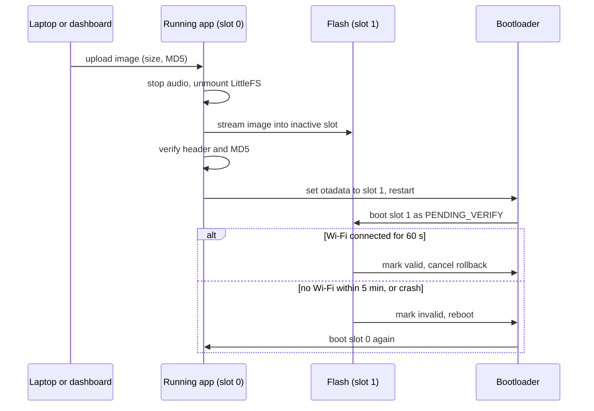
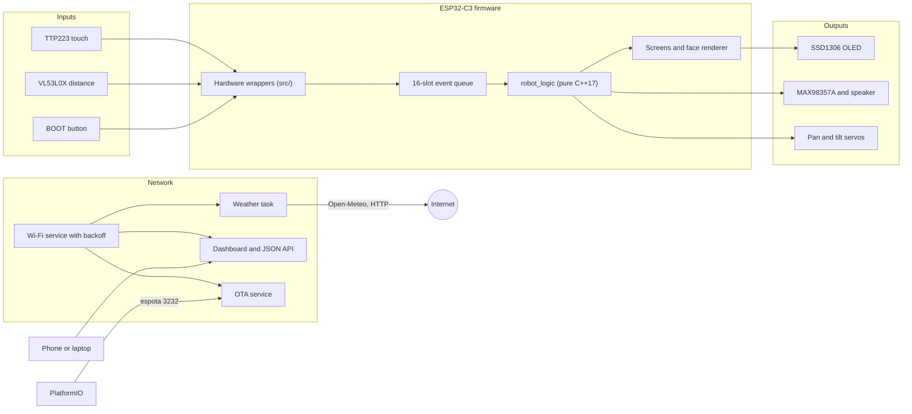
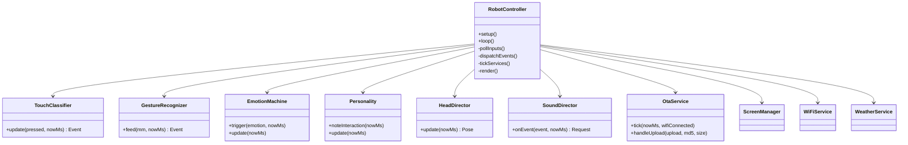
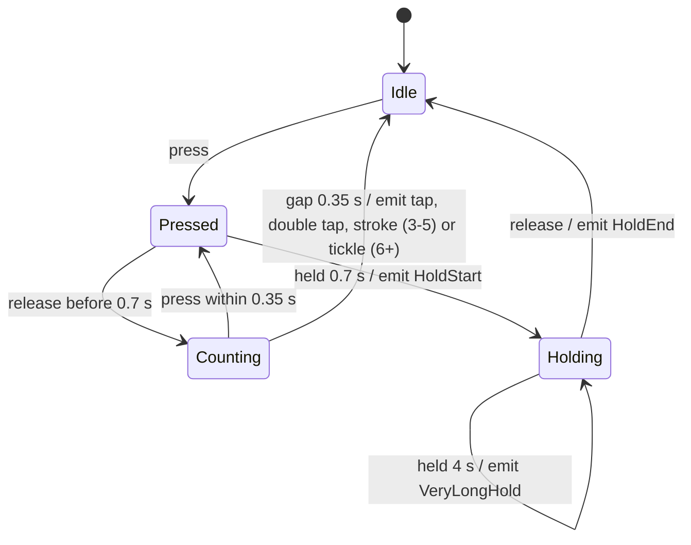
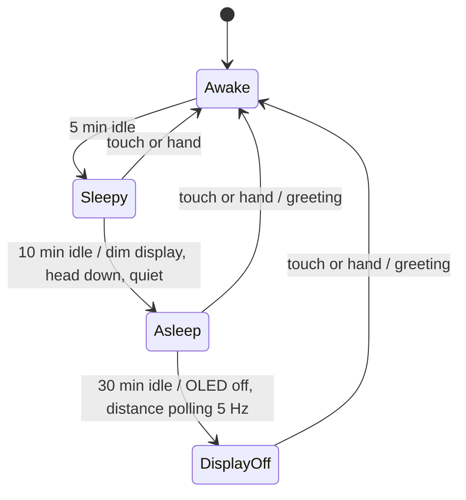

## Overview

PicoPal is a small desk robot. A 128 by 64 OLED shows a face with eyes that blink, look around and change shape with mood. Tap it and it gets annoyed, double-tap and it sulks, hold a finger on it and it melts into heart eyes. Wave a hand above it and it changes screens; hover and it selects. It talks in chirps and short voice clips, nods and shakes its head on two hobby servos, shows weather and time, plays a one-button game, and serves a dashboard to any phone on the same Wi-Fi.

The interesting part is not any single feature. It is making a pile of unreliable parts (a flickering distance sensor, a bouncing touch pad, a radio that drops, a single CPU core shared with Wi-Fi) behave like one responsive character that never freezes. The approach was a hard split between hardware wrappers and a pure C++ logic library, so nearly every behaviour could be tested on a laptop before it ever ran on the board.

The build is complete. Every subsystem has been run on the real board: display, touch, distance sensing and diagnostics (checks H1–H8), sound (A1–A9) and the head (M1–M8). What remains is long-run validation and battery power, listed in [Planned but Restricted](#planned-but-restricted).

<PhotoSlot caption="The assembled robot on a desk: OLED face on the pan-tilt head, sensor and touch pad on the base." />

## Problem Statement

### The problem

A desk companion has to feel alive, and "alive" is mostly about latency and consistency. The face must keep animating while the robot fetches weather, writes flash, streams audio or reconnects to Wi-Fi. A touch has to land as exactly one gesture: a tap must not briefly flash as the start of a double tap, and a double tap must not show the single-tap reaction first. And the whole thing has to keep working when a sensor is unplugged or the network is gone.

### Why it matters

These are the same problems every small connected device has, in miniature: cooperative scheduling on one core, debouncing noisy inputs into clean events, failure isolation between subsystems, flash budgets, and updating firmware remotely without bricking the device. A robot makes failures visible immediately: a stalled loop is a frozen face.

### Who has this problem

Anyone building a hobby or prototype device on an ESP32-class board with several peripherals: a display, a couple of sensors, audio, motors and Wi-Fi. The usual starting point is one large Arduino sketch, and that is exactly where this project started: an 812-line single-file prototype with spring-physics eyes and a weather page.

### Limits of the usual approach

- **One big sketch with `delay()`** works until two things need to happen at once. Then the face stutters every time the network is busy.
- **Logic mixed with I/O** cannot be tested without flashing the board, so every change costs a build-flash-observe cycle measured in minutes.
- **USB-only updates** mean unplugging the robot from its place on the desk for every change.
- **Hard-coded credentials and API keys** in the sketch (the prototype had both) leak the moment the code is shared.

### Goals and requirements

| Requirement | Target |
|---|---|
| Always responsive | No blocking calls in the loop; face at 25 FPS or more during sound, motion and network work |
| Works offline | Face, touch, gestures and game need no network; Wi-Fi only adds weather and time |
| One clean event per touch | Tap, double tap, stroke, tickle, hold and very long hold, each classified once |
| Fault tolerant | Any sensor may be missing or fail at runtime; the robot logs it and keeps running |
| Testable | Every decision-making component runs on the host with unit tests |
| Remote updates | Over-the-air firmware and filesystem updates, with automatic rollback |
| No secrets in code | Wi-Fi credentials set on the device and stored in flash; weather API with no key |

## Proposed Solution

### Approach

I rebuilt the prototype as a layered PlatformIO project. Everything that decides something lives in `lib/robot_logic`: pure C++17, no Arduino calls, and time is passed in as an argument (`nowMs`) instead of read from a clock. Everything that touches a pin or a bus lives in thin wrappers under `src/`. A single `RobotController` owns all modules and runs one cooperative, millisecond-based loop. Network calls and audio rendering run in their own FreeRTOS tasks so they can block without stopping the face.

### How it answers each requirement

- **Responsive:** the loop never calls `delay()`. The longest step is sending one OLED frame (about 25 ms at 400 kHz I2C). Weather runs in a task, audio in a higher-priority task fed through a queue, and the head runs in the loop with eased motion that costs microseconds per tick.
- **Offline-first:** Wi-Fi is a service with its own state machine and backoff (5, 10, 30, 60, then 300 seconds). Nothing else waits on it.
- **Clean touch events:** a `TouchClassifier` turns raw pad edges into exactly one event per gesture, and an `EmotionMachine` arbitrates nine emotions with explicit priority rules.
- **Fault tolerant:** each sensor is optional at runtime. An init failure logs, disables the feature and retries every 30 seconds. The distance sensor is hard-reset through its XSHUT pin after 10 consecutive bus errors.
- **Testable:** 144 Unity tests in nine suites run on the laptop with `pio test -e native`.
- **Remote updates:** a custom partition table with two app slots, ArduinoOTA plus a dashboard upload, and bootloader rollback that only commits a new image after it has proven it can reach the network.
- **No secrets:** credentials are entered through a captive portal or the serial console and stored in NVS. Weather comes from Open-Meteo, which needs no API key.

### Key features

- Animated face with pupils, blinking, saccades, nine emotions and idle animations (hum, wink, yawn, look-around).
- Touch: tap, double tap, stroke, tickle, hold, very long hold. Hand gestures above the robot: present, approach, hover-select, wave, double wave.
- Seven screens: Home (face), Weather, Clock, Info, Settings, Game and Canvas (draw on the dashboard, show it on the OLED).
- Sound: 20 synthesized sounds plus 13 short voice clips on the flash filesystem.
- Pan-tilt head with emotion poses, 14 named moves synced to face animations, idle wandering, and calibration.
- Personality: awake, sleepy after 5 minutes, asleep and dimmed after 10, display off after 30; touch or a hand wakes it with a greeting.
- Web dashboard and JSON API, serial console, OTA updates with rollback.

### Technical decisions and trade-offs

| Decision | Why | Trade-off | Alternative considered |
|---|---|---|---|
| Inject time into all logic | Deterministic tests, no hidden sleeps | Every caller passes `nowMs` | Mocking `millis()`: global state, fragile |
| Distance sensor facing up | Hand gestures above the robot work in any room | No direction: "swipe left/right" is impossible, so waves replace swipes | PIR for presence: dropped, the ToF already detects an approaching hand |
| Touch module instead of on-chip touch | The C3 has no capacitive touch peripheral | One more module | None on this chip |
| U8g2 for the OLED | One-line switch between SSD1306 and SH1106, small fonts, 1 KB frame buffer | Its API is lower-level than Adafruit GFX | Adafruit_SSD1306: separate library for SH1106, larger |
| IDF `i2s_std` driver directly | Control over DMA depth and silence on underrun | More code than the Arduino wrapper | `ESP_I2S` wrapper |
| Own 80-line MPU6050 driver | The common library blocks with `delay()` during calibration | Maintaining a register driver | `MPU6050_tockn` |
| Custom Wi-Fi portal | Needed extra fields and must stay non-blocking | More code | WiFiManager: blocking, hard to extend |
| Servos detached when still | No idle buzz, about 10 mA instead of about 100 mA per servo | A heavy head can sag while relaxed | Holding PWM: noisy |
| Servo tilt on GPIO1, not GPIO2 | GPIO2 is a strapping pin; a servo line could change boot mode | Used the pin freed by dropping the PIR | — |
| Dashboard without auth | Fast to build for a trusted home network | Anyone on the LAN can control or reflash it | Token auth: listed as restricted scope |

## Bill of Materials

Prices are rough Indian retail ranges at the time of writing, for planning a build. They are **estimates, not receipts**; I did not record what I paid.

<Callout type="assumption" title="Prices are estimates">
Ranges are typical listings on Robu.in, Amazon.in and AliExpress for generic modules. Clone boards vary in quality; buy one spare of the cheapest parts (touch module, OLED).
</Callout>

| Part | Qty | Purpose | Approx. price (INR) | Notes |
|---|---|---|---|---|
| ESP32-C3 SuperMini | 1 | Main controller | 250–400 | Native USB-C; pin order differs between clones |
| 0.96 in SSD1306 OLED, I2C, 4-pin | 1 | Face and screens | 180–300 | Some modules are SH1106 (firmware switch exists) |
| VL53L0X breakout (GY-530 style) | 1 | Hand presence and gestures | 250–450 | Use a breakout with regulator; the bare chip is 2.8 V max |
| TTP223 touch module | 1 | Touch pad | 15–40 | Power from 3.3 V only |
| MAX98357A I2S amplifier breakout | 1 | Sound | 200–400 | Clone boards need SD tied high |
| Speaker, 4–8 Ω, 2–3 W, about 40 mm | 1 | Sound | 60–150 | Small speakers drop out below about 600 Hz |
| SG90 micro servo | 2 | Pan and tilt | 200–360 for two | Comes with horns and screws |
| 5 V, 2 A or more supply (buck module or adapter) | 1 | Servo power | 100–300 | Separate from the board's USB power |
| Electrolytic capacitor 470–1000 µF, 10 V or more | 1–2 | Servo rail, amp rail | 10–40 | Mind the polarity |
| 10 µF + 100 nF capacitors | 1 each | 3.3 V rail decoupling near sensors | 10–20 | Optional, helps with Wi-Fi brown-outs |
| 4.7 kΩ resistors | 2 | I2C pull-ups if a scan finds nothing | 5 | Usually not needed |
| MPU6050 (GY-521) | 1 | Optional motion sensor | 150–250 | Detected only in this firmware |
| Breadboard and jumper wires (M-M, F-F) | 1 set | Wiring | 150–300 | Keep I2C wires short |
| USB-C data cable | 1 | Power and flashing | 100–250 | A charge-only cable will not flash |
| Base board, hot glue gun and sticks, knife, small screwdriver | — | Mechanical build | 200–400 for the glue gun | Any flat rigid base works |

**Parts total, excluding tools: roughly ₹1,700–3,200** (estimate).

## Circuit and Pin Map

Every module except the servos runs on the board's 3.3 V rail, and the amplifier takes 5 V. Two shared buses carry most signals: I2C for the display and the distance sensor, I2S for audio. The schematic below uses net labels: the same name means the same wire.

<Figure label="Fig. 1" caption="Circuit by net label. SDA/SCL are shared by the OLED and the VL53L0X; the servos take signals from the board but power from a separate supply with a common ground. Illustration, not a photo.">


</Figure>

### Pin map

| GPIO | Function | Direction | Notes |
|---|---|---|---|
| 6 | I2C SDA | bidirectional | OLED, VL53L0X, optional MPU6050 |
| 7 | I2C SCL | out | 400 kHz |
| 4 | TTP223 output | in | Active-high by default; polarity configurable |
| 3 | VL53L0X XSHUT | out | Optional; lets the firmware hard-reset a hung sensor |
| 5 | I2S BCLK | out | To MAX98357A |
| 10 | I2S LRC (word select) | out | To MAX98357A |
| 21 | I2S data out | out | Also UART0 TX: the ROM boot log makes one click at reset |
| 20 | Pan servo signal | out | UART0 RX, an input at boot, so no boot noise |
| 1 | Tilt servo signal | out | Chosen over GPIO2 to keep servos off strapping pins |
| 8 | Onboard LED | out | Active-low; lights while touched (diagnostic) |
| 9 | BOOT button | in | Extra "home" button after boot; LOW at reset enters download mode |
| 0 | Battery ADC | analog in | Reserved for later, through a 100k/100k divider |
| 2 | Spare | — | Strapping pin: never pull it low at reset |

The C3 SuperMini exposes 13 usable GPIOs (0–10, 20, 21); 12 are allocated. Pins 11–17 belong to the embedded flash and 18/19 are USB.

### I2C addresses

| Address | Device | Required | On failure |
|---|---|---|---|
| `0x3C` (some modules `0x3D`) | SSD1306 OLED | yes | Serial error and LED blink code; firmware keeps running headless |
| `0x29` | VL53L0X | no | Gestures disabled, touch-only control, retry every 30 s |
| `0x68` (`0x69` if AD0 high) | MPU6050 | no | Motion features disabled |

<Details summary="Strapping pins on the ESP32-C3, and why they constrain the pin map">
GPIO2, GPIO8 and GPIO9 are sampled at reset to choose the boot mode. GPIO9 low means "download mode" (that is what the BOOT button does). GPIO8 and GPIO2 must not be held low at reset either. Anything wired to these pins, such as a servo signal line pulled low by the servo's input, can stop the board from booting normally. That is why the tilt servo moved from GPIO2 to GPIO1, and why GPIO2 stays spare.
</Details>

## Power

<Figure label="Fig. 2" caption="Power domains. USB feeds the board and amplifier; a separate 5 V supply feeds only the servos; every ground is shared. Currents are datasheet-level estimates from my notes, not measurements. Illustration, not a photo.">


</Figure>

There are three rails:

1. **USB 5 V** from the USB-C port, passed through to the board's 5V pin. The MAX98357A runs from here; it is louder at 5 V than at 3.3 V and peaks around 0.6 A on loud sounds.
2. **3.3 V** from the SuperMini's onboard regulator, roughly 500 mA for everything. The ESP32-C3 itself draws 25–80 mA with spikes around 350 mA when Wi-Fi transmits. The OLED, distance sensor and touch pad add well under 50 mA together.
3. **External 5 V, 2 A or more**, for the servos only. An SG90 can draw about 650 mA when stalled. Two of them on the board's rail will brown out the ESP32 the first time the head shakes.

<Callout type="warning" title="Servo power">
Never power the servos from the board's 3V3 pin, its 5V pin, or a GPIO. Use the separate supply, put a 470–1000 µF capacitor across it near the servos, and join its ground to the board's ground. Without the common ground the servo signal has no reference and the head jitters at random.
</Callout>

Two cheap additions remove most power problems: a 10 µF plus 100 nF pair across 3.3 V and ground near the sensors (Wi-Fi transmit dips), and a 100–470 µF capacitor across the amplifier's supply if the board resets on loud sounds. The most common cause of brown-out resets is still the USB cable: use a short one from a 1 A or better port.

## Wiring Step by Step

Wire one subsystem at a time and check it before adding the next. Each stage below ends with a test the firmware can already run; the serial console commands are in [Firmware Setup and Flashing](#firmware-setup-and-flashing).

1. **Board only.** Plug in the SuperMini, flash the firmware once (next section) and open the serial monitor. You should see a boot banner with chip, flash size and reset reason. If the upload cannot connect, hold BOOT, tap RESET, release and retry.
2. **OLED.** VCC to 3V3, GND to GND, SDA to GPIO6, SCL to GPIO7. Reboot. Type `scan`: `0x3C` should appear and the face should be centred. A 2-pixel shift with a garbage column means the module is an SH1106, not an SSD1306; flip the switch in `config.h`.
3. **Distance sensor.** VIN to 3V3, GND, SDA and SCL onto the same bus, XSHUT to GPIO3. Peel the protective film off the sensor window. Mount it **facing up**. `scan` should now list `0x29`. Type `t` to stream millimetre readings; a hand at 10, 20 and 40 cm should read within about 20 mm.
4. **Touch pad.** VCC to **3V3** (not 5 V: the output follows the supply), GND, I/O to GPIO4. The onboard LED should light while you touch the pad. A tap shows the angry face within about 400 ms of release.
5. **Amplifier and speaker.** VIN to 5V, GND, BCLK to GPIO5, LRC to GPIO10, DIN to GPIO21, **SD to 3V3**, speaker to OUT+ and OUT−. Leave GAIN open (9 dB). Type `sfx hi`. Silence with `playing` in the `audio` status means the amplifier side: check SD first.
6. **Servos, without horns.** Signal wires to GPIO20 (pan) and GPIO1 (tilt), red wires to the external 5 V, brown wires to the external ground **and** the board ground. Capacitor across the servo supply. Power order: servo supply on first, then USB. At boot the shafts snap once to "head down"; that is expected, because an SG90 cannot report its position.
7. **Tidy up.** Keep I2C wires under 20 cm, keep servo wires away from I2C wires, and twist each servo's signal and ground together if the head jitters.

<Details summary="I2C pull-ups: when to add them">
The OLED and VL53L0X breakouts each carry 4.7–10 kΩ pull-ups. In parallel that is roughly 3–5 kΩ, which is right for 400 kHz on short wires. Only add 4.7 kΩ from SDA and SCL to 3V3 if `scan` finds nothing and the wiring is definitely correct. Breadboard contacts are a more common culprit than missing pull-ups.
</Details>

<PhotoSlot caption="Breadboard stage after step 5: board, OLED, distance sensor, touch pad and amplifier wired; servos not yet connected." />

## Mechanical Assembly

I had no 3D printer and no pan-tilt bracket, so the head is three hot-glue joints. Hot glue is weak on edges and strong on flat faces, so every joint is flat-on-flat, which is why the pan servo is mounted **upside down**: its horn is glued to the base and its body turns.

<Figure label="Fig. 3" caption="Glue-gun head. Joint A: pan horn to base. Joint B: tilt horn to the pan servo's wide face. Joint C: OLED back to the tilt servo's front face. Illustration, not a photo.">


</Figure>

### Step 1: zero the servos in firmware

With the horns off, power the servo supply and then USB, open the serial monitor and type:

```bash
# title: zero both servos before any glue
head calm              # motion on, idle wandering off
servo pulse 500 2400   # SG90 defaults
servo limit pan -60 60
servo limit tilt -20 25
servo trim pan 0
servo trim tilt 0
head center            # both shafts to 90° = zero
servo                  # expect "pulses 1450/1450 us"
head off               # PWM stops now and is saved: servos stay limp at zero
```

Unplug everything. From here on, do not turn the shafts. Put a marker dot on each servo body.

### Step 2: horns and surfaces (power off)

Fit a cross horn on the pan servo and a single or double arm on the tilt servo, holding the body rather than the horn. Cross-hatch the flat face of both horns with a knife, and scratch off the label on one wide face of each servo. Horn plastic is slippery and glue will not hold otherwise.

### Step 3: joint A, pan servo to base

Put a coin-sized blob of glue on the base. Press the upside-down pan servo's horn into it. Before it sets, rotate the **body** so its long side points front to back; that direction becomes "straight ahead". Hold for 60 seconds, then run a bead around the horn edge, away from the shaft gap.

### Step 4: joint B, tilt servo to pan servo

Glue the tilt horn face onto the upper half of the pan servo's scratched wide face. Before it sets, stand the tilt body straight up from its shaft with its wide face to the front. Leave a 4–5 mm gap between the two bodies; they must not touch.

### Step 5: joint C, OLED to tilt servo

Plug the four jumpers onto the OLED header first; the pins are hard to reach afterwards. Glue a zig-zag onto the tilt servo's front face (never onto the OLED), then press the OLED's back onto it, holding only the PCB edges, header at the top. Keep glue away from the glass and the thin ribbon at the bottom edge. Let all joints cure for 10 minutes.

### Step 6: wires

Leave an 8–10 cm slack loop for the OLED jumpers and both servo cables (the pan servo's body turns, so its cable moves too). Anchor the bundle with one glue dot on the base about 5 cm from the head.

A mistake is recoverable: a drop of isopropyl alcohol at the glue edge lets it peel off cleanly.

<PhotoSlot caption="Close-up of the finished head from the side: upside-down pan servo, tilt servo, OLED and the wire slack loop." />

## Firmware Setup and Flashing

### Toolchain

I use PlatformIO with the community-maintained **pioarduino** platform, because the official `espressif32` platform stays on Arduino core 2.x. The platform is pinned to a release, so a build today uses exactly the same core as mine.

```bash
# title: install PlatformIO (macOS; on Linux/Windows use pip or the VS Code extension)
brew install platformio
pio --version
```

```ini
# title: platformio.ini (excerpt)
[env:esp32c3]
platform = https://github.com/pioarduino/platform-espressif32/releases/download/55.03.312-1/platform-espressif32.zip
board = esp32-c3-devkitm-1
framework = arduino
board_build.partitions = partitions.csv   ; two 1.625 MB OTA slots + 640 KB LittleFS
board_build.filesystem = littlefs
monitor_speed = 115200
build_flags =
  -DARDUINO_USB_MODE=1          ; native USB-Serial/JTAG
  -DARDUINO_USB_CDC_ON_BOOT=1   ; Serial goes to USB
extra_scripts = pre:scripts/embed_web.py   ; gzips the dashboard into a header
lib_deps =
  olikraus/U8g2@2.36.18
  pololu/VL53L0X@1.3.1
  bblanchon/ArduinoJson@7.4.3

[env:native]                    ; host tests for lib/robot_logic
platform = native
test_framework = unity
build_flags = -std=c++17 -Wall -Wextra
```

### Build, test and first flash

```bash
# title: from the project folder
pio test -e native              # host tests, no board needed
pio run -e esp32c3              # build firmware
pio run -e esp32c3 -t upload    # first flash MUST be over USB (writes the partition table)
pio run -e esp32c3 -t uploadfs  # voice clips into the LittleFS partition
pio device monitor              # serial console at 115200
```

The first flash has to be over USB because it writes the custom partition table, and an over-the-air update can only replace an app image, never the table. After that, everything can go over Wi-Fi.

### Voice clips

The 13 voice clips are short WAV files generated on a Mac with the built-in `say` command and trimmed and normalized by a small script, then placed in `data/voice/` for `uploadfs`. Clips must be mono PCM, 8- or 16-bit, 8–22 kHz. Phrases have to be real words: the text-to-speech engine spelled out "Hmph" letter by letter, so the angry clips became "Ouch!" and "Hey, stop it!".

### Useful console commands

| Command | Does |
|---|---|
| `help` | Lists every command |
| `diag` / `scan` | Chip, heap and status / I2C devices found |
| `t` | Streams distance readings |
| `emo sad`, `anim wink` | Triggers an emotion or animation |
| `sfx list`, `sfx hi`, `vol 60`, `audio` | Sounds, volume and audio status |
| `head center`, `move nod`, `servo sweep` | Head control and calibration |
| `wifi "<ssid>" <password>`, `portal` | Wi-Fi setup |
| `factory yes` | Erases settings, credentials and calibration, then restarts |

## First Boot and Configuration

On power-up the face plays a wake-up scene: asleep, peek, yawn, eyes open, look left and right, then "hi!", about 4.6 seconds in total and interruptible by a touch. The head rises with the scene and nods at "hi".

With no saved Wi-Fi, open **Settings → Wi-Fi setup** on the robot (wave to move between screens, hover to select). It starts a captive portal: an access point named after the robot with a random 8-digit WPA2 password shown on the OLED. Join it from a phone; the setup page opens by itself (or browse to the portal address the OLED shows). Enter the network, password, location for weather and timezone. The portal closes 1.5 seconds after saving, or after 10 minutes idle. Alternatively, use `wifi "<ssid>" <password>` on the serial console.

<Callout type="note" title="2.4 GHz only">
The ESP32-C3 cannot use 5 GHz Wi-Fi. If your network is not found, enable the router's 2.4 GHz band. Many SuperMini boards have a poorly matched antenna; if connections time out, set **Settings → Wi-Fi power: low**.
</Callout>

Once connected, the robot syncs time over NTP, fetches weather from Open-Meteo every 15 minutes (cached in flash, with an offline badge when data is older than 45 minutes), and serves the dashboard on port 80. The dashboard is one HTML file, gzipped into the firmware at about 9–13 KB. It has cards for emotions, sound, head control and calibration, the drawing canvas, settings, and firmware upload. The address is shown on the Info screen; I use the IP address rather than the `.local` name, because mDNS took about 5 seconds to resolve on macOS and failed on most Android phones.

<PhotoSlot caption="Screenshot of the web dashboard on a phone: emotion buttons, Head card with live sliders, Sound card." />

## OTA Updates and Safe Flashing

Remote updates are the feature most likely to brick a device, so I treated them as a small system of their own.

<Figure label="Fig. 4" caption="Flash layout. An update always writes the slot that is not running; otadata records which slot boots and whether the new image is still on probation. Illustration, not a photo.">


</Figure>

### The partition table

```text
# title: partitions.csv
# Name,   Type, SubType,  Offset,   Size,     Flags
nvs,      data, nvs,      0x9000,   0x5000,
otadata,  data, ota,      0xe000,   0x2000,
app0,     app,  ota_0,    0x10000,  0x1A0000,
app1,     app,  ota_1,    0x1B0000, 0x1A0000,
spiffs,   data, spiffs,   0x350000, 0xA0000,
coredump, data, coredump, 0x3F0000, 0x10000,
```

Two app slots of 1.625 MB each, a 640 KB LittleFS partition for voice clips (the label stays `spiffs` for tooling compatibility), and NVS at the same offset as the stock table so saved settings survived the switch. The firmware is 1.53 MB, 89.8% of a slot, which is why the dashboard is embedded gzipped and why the slot size is a budget I watch on every build.

### Two ways to push an update

```bash
# title: over-the-air from the laptop (ArduinoOTA / espota on port 3232)
pio run -e esp32c3_ota -t upload       # firmware
pio run -e esp32c3_ota -t uploadfs     # voice clips
# if the .local name does not resolve, pass the IP:
pio run -e esp32c3_ota -t upload --upload-port <robot-ip>
```

The second way is the dashboard: choose a `.bin` file and upload it. The page sends the file size and an MD5 digest with the upload, and the firmware streams it into the inactive slot through the `Update` library, which checks the image header on the first chunk and the digest at the end. Both paths draw a progress bar on the OLED, and both stop the audio task and unmount the filesystem first, so nothing else is writing flash during the update.

### How rollback works

The prebuilt bootloader in Arduino-ESP32 has app rollback enabled. Normally the Arduino core marks a freshly booted image as good straight away; I override that hook so the firmware decides:

```cpp
// title: OtaService.cpp (excerpt)
// Tell the core not to mark a freshly updated firmware as good at boot.
extern "C" bool verifyRollbackLater() { return true; }

void OtaService::tick(uint32_t nowMs, bool wifiConnected) {
  if (pendingVerify_ && !markedValid_) {
    if (wifiConnected && nowMs >= config::kOtaHealthyAfterMs) {          // 60 s
      esp_ota_mark_app_valid_cancel_rollback();
      markedValid_ = true;
    } else if (!wifiConnected && nowMs >= config::kOtaRollbackDeadlineMs) { // 5 min
      esp_ota_mark_app_invalid_rollback_and_reboot();
    }
  }
}
```

A new image boots in the `PENDING_VERIFY` state. It is marked valid only after it has run for 60 seconds **with Wi-Fi connected**, because the one thing a remotely updated device must keep is the ability to receive the next update. If Wi-Fi never comes up within 5 minutes, the firmware marks itself invalid and reboots into the previous slot. If it crashes before either point, the bootloader sees an unconfirmed image on the next boot and rolls back on its own. The dashboard's status shows the running slot and its rollback state.



### Flashing without corruption: my checklist

- **Never change the partition table over the air.** OTA only writes app slots. A table change needs one USB flash, then `uploadfs` again (the filesystem moves with the table).
- **Check the image fits.** The build prints flash usage; anything over the 1.625 MB slot is rejected by `Update.begin`, but I keep headroom and treat 90% as the warning line.
- **Stable power during the update.** Updates block the main loop and write flash for several seconds. Do not update on a weak USB port or while the servos are moving. If power does drop mid-write, the half-written slot is never selected, because otadata switches only after verification, so the old firmware boots; you just have to upload again.
- **Verify before switching.** The MD5 and header checks run before otadata is touched. A failed or aborted upload leaves the running image untouched and shows "Update failed" on the OLED; the robot keeps running.
- **Prove it before committing.** Let the new firmware reach Wi-Fi and run for a minute before power-cycling.
- **USB is the last resort.** If both slots are bad, hold BOOT, tap RESET, release, and flash over USB: the ROM bootloader cannot be overwritten by an app update.

<Callout type="warning" title="No authentication">
The dashboard and both OTA paths have no password. Anyone on the same network can reflash the robot. It belongs on a trusted home network only; adding authentication is in the restricted scope below.
</Callout>

## Architecture

### High-level design

The diagram shows where each concern lives. Read it left to right: inputs become events, events go through the logic layer, and the logic layer drives outputs. Network services hang off the side and never sit in that path.



Three FreeRTOS tasks share the single core: the Arduino loop (priority 1) runs everything in the main path, a weather task (priority 1) does one blocking HTTP request at a time and hands back the result under a mutex, and an audio task (priority 3) renders 256-sample blocks into a DMA buffer that covers about 96 ms of stalls. The loop never touches the network directly.

### Low-level design

**Module ownership.** `RobotController` owns every module and wires them together. Console commands and web API routes are thin adapters over the same shared actions, so the dashboard and the serial console can never drift apart.



Everything in that diagram except `RobotController`, `ScreenManager`, the services and the OTA service is pure logic in `lib/robot_logic`, compiled for both the board and the host.

**Touch classification.** The classifier waits 0.35 s after a release to see whether another tap follows, which is the price of never showing the wrong reaction first.



**Personality and power stages.** Idle time drives the robot towards sleep; any touch or approaching hand resets it, and the first touch after sleep only wakes it (input is ignored for 1.2 s so the wake-up touch does not also count as a tap).



**Event routing.** Inputs become `InputEvent {source, code, atMs}` records in a 16-slot queue. The screen manager dispatches in a fixed order: BOOT or the Home gesture always returns home; an open interactive screen gets everything else; otherwise the current screen may consume the event; unconsumed events become navigation (wave or tap for next, double wave or double tap for previous, hover-select to open).

**Head motion.** `HeadDirector` produces a target pose from the emotion, sleep stage and hand presence, layers keyframed moves on top (shake, nuzzle, startle, bounce, look, scan and others, each ending at the pose), and `ServoAxis` eases between angles with a smoothstep curve at 60, 120 or 240 degrees per second. `HeadController` converts angles to pulses through the calibration (trim, limits, invert, pulse range) and writes LEDC duty at 50 Hz with 14-bit resolution only when it changes. PWM switches off 0.5 s after the head stops.

**JSON API.** The dashboard uses a small REST surface on port 80:

| Method | Route | Purpose |
|---|---|---|
| GET | `/api/state` | Live status: emotion, screen, Wi-Fi, OTA slot and rollback state, audio, head |
| GET / POST | `/api/settings` | All settings and emotion tuning; POST validates a subset, saves, applies |
| POST | `/api/emotion`, `/api/anim`, `/api/screen` | Trigger an emotion (optionally locked), an animation, a screen |
| GET / POST | `/api/head` | Head state and calibration; pose, move, sweep, mode, speed |
| GET / POST | `/api/sound` | Sound list; play a synth sound or clip |
| GET / POST | `/api/canvas` | 128×64 1-bit bitmap to show on the Canvas screen |
| POST | `/api/cmd` | Run any console line and return its output |
| POST | `/api/ota?size=…&md5=…` | Multipart firmware upload |

**Persistence.** Settings, Wi-Fi credentials, weather cache, emotion tuning, game high score, canvas and servo calibration live in one NVS namespace. Writes are rate-limited (settings on save, high score when beaten, statistics every 10 minutes) to spare the flash.

## Implementation

### Technology stack

PlatformIO, pioarduino platform `55.03.312-1` (Arduino-ESP32 3.3.12), U8g2 2.36.18, Pololu VL53L0X 1.3.1, ArduinoJson 7.4.3, Unity for host tests, LittleFS, FreeRTOS, ArduinoOTA, ESPmDNS, the IDF `i2s_std` driver, and the core's `WebServer`, `DNSServer`, `HTTPClient` and `Preferences`.

### Important implementation decisions

- **No dynamic allocation in the loop.** No `String` in render or sensor paths; `snprintf` into fixed buffers; a fixed 16-slot event queue; configuration as `constexpr`.
- **Render only when needed.** Home redraws every frame up to the 30 FPS cap; static screens redraw once a second or on change. That keeps I2C traffic and CPU low.
- **Sound with integers only.** The C3 has no FPU, so the synthesizer uses integer oscillators (sine, triangle, square, pulse, noise) with pitch glides and a 5 ms attack and 20 ms release. The output chain is a 300 Hz high-pass (the speaker cannot play bass anyway), a squared volume curve with up to 3× gain, and a soft limiter.
- **Sounds and moves are chosen by pure logic.** `SoundDirector` and `HeadDirector` decide what plays when (priorities, rate limits, quiet while asleep), and the hardware wrappers only execute.
- **A stuck bus is reset, not tolerated.** If SDA is held low at boot, the firmware clocks SCL nine times and sends a STOP. The distance sensor is hard-reset through XSHUT after 10 consecutive errors.

### Testing strategy

Two layers. On the host, `pio test -e native` runs 144 Unity tests across nine suites (touch, emotion, gesture, personality, services, game physics, tuning, head and audio): debounce boundaries, emotion priorities, gesture spike rejection and cooldowns, Open-Meteo parsing of malformed responses, Wi-Fi backoff, servo easing and calibration, synth output and WAV header parsing. Some behaviour was also checked by running firmware code on the host: face frames rendered to PNG through U8g2, sounds rendered to WAV, and head timelines simulated against the face animations.

On the board, numbered checklists cover what the host cannot: H1–H8 for bring-up, A1–A9 for sound and M1–M8 for the head, all passed. They are reproduced in [Testing and Calibration](#testing-and-calibration) so you can run them on your own build.

## Testing and Calibration

### Bring-up (H1–H8)

| # | Test | Pass condition |
|---|---|---|
| H1 | Boot and I2C scan | Serial lists `0x3C`, `0x29` (and `0x68` if fitted) |
| H2 | OLED | Face centred, no 2-pixel garbage column |
| H3 | Touch press | LED on GPIO8 lights while touched; press logged |
| H4 | Single tap | Angry face within 400 ms of release; happy again after about 3 s |
| H5 | Double tap | Sad face, never a brief angry face first |
| H6 | Hold or stroke | Loved while held; fades about 5 s after release |
| H7 | Distance sensor | Readings stream at about 30 Hz; hand at 10/20/40 cm within ±20 mm; no stutter |
| H8 | Sensor unplugged | Error logged, face keeps running; replugged sensor recovers within 30 s |

### Sound (A1–A9)

| # | Test | Pass condition |
|---|---|---|
| A1 | Boot | Audio ready with N clips; chime, yawn and "hi" in time with the wake-up scene |
| A2 | Every sound | Each `sfx <name>` audible without crackle; `say hi` plays the clip |
| A3 | Touch emotions | Tap, double tap, hold give angry, sad, loved sounds; double tap never plays angry first |
| A4 | No stutter | Face at 25 FPS or more while sounds play, including during a weather fetch |
| A5 | Priority | A voice sound cuts an ambient hum; a short effect is dropped while a voice plays |
| A6 | Quiet when asleep | Says "bye" falling asleep, then silent; a hand wakes it with "hi" |
| A7 | Settings | Volume, voice, UI sounds and pitch survive a reboot |
| A8 | Updates | OTA upload during a sound succeeds; `uploadfs` over Wi-Fi replaces the clips |
| A9 | Power | Loud sounds at volume 100 cause no brown-out |

### Head (M1–M8)

| # | Test | Pass condition |
|---|---|---|
| M1 | Boot | Head goes down, rises with the wake-up scene, looks left and right, nods at "hi" |
| M2 | Calibration | `servo sweep` clears both end stops; trim makes `head center` straight and level |
| M3 | Moves | Every `move <name>` is smooth; face stays at 25 FPS or more |
| M4 | Emotions | Tap: shake and glare. Double tap: droop, held while sad. Hold: chin up and nuzzle |
| M5 | Hand | Hand above: head looks up; hand gone: level |
| M6 | Sleep | Falling asleep: head down, servos silent; touch or hand wakes it with a nod |
| M7 | Power | Shake plus loud sound together: no brown-out |
| M8 | Persistence | Mode, speed and calibration survive a reboot; dashboard sliders move the head live |

### Calibrating the head

After assembly: `head center`, then `servo trim pan <deg>` and `servo trim tilt <deg>` until the face looks straight ahead and level. `head 30 0` should turn to **your** right and `head 0 15` should look up; if not, `servo invert pan` or `servo invert tilt` (pan usually needs inverting, because that servo is upside down). Then `servo sweep`: if anything presses against the base or pulls a wire, narrow the range with `servo limit pan -45 45` and `servo limit tilt -15 20`. Buzzing at an end means the servo is past its travel; lower the limit. All of this is also on the dashboard's Head card and is saved in NVS.

### Distance sensor calibration

Run **Settings → Calibrate** (or `calib`) with nothing above the sensor for about 50 cm. If gestures fire on their own near a shelf, calibrate again or choose **Sensitivity: near**. Sunlight through a window adds infrared noise and shortens the range.

## Troubleshooting

Open the serial monitor first and type `diag` or `scan`. Logs are tagged by subsystem (`[input]`, `[tof]`, `[audio]`, `[head]`, `[wifi]` and so on).

| Symptom | Likely cause | Fix |
|---|---|---|
| Upload: "No serial data received" | Board not in download mode | Hold BOOT, tap RESET (or replug while holding BOOT), release, upload |
| No serial output after flashing | Native USB re-enumerated | Reopen the monitor; type `diag` to reprint the banner |
| `BROWN-OUT` in the boot banner | Weak USB port or long cable | Short cable, 1 A port, 10 µF + 100 nF at the sensors |
| `scan` finds no devices | Wiring or missing pull-ups | SDA GPIO6, SCL GPIO7, 3V3, GND; add 4.7 kΩ pull-ups only if needed |
| Bursts of I2C `INVALID_STATE` errors | Driver stuck after a glitch, often a 3.3 V dip during Wi-Fi transmit | Firmware resets the bus; add 10–100 µF at the sensor, Wi-Fi power low |
| Image shifted 2 px with a garbage column | SH1106 module, not SSD1306 | Flip the OLED controller switch in `config.h` |
| Touch reads "touched" for over 60 s | Module jumper set to active-low | Change touch polarity in `config.h` |
| Gestures fire on their own | Something static above the sensor | Calibrate with the area clear; Sensitivity: near |
| Amp silent although audio says "playing" | SD pin floating on a clone board | Tie SD to 3V3; check VIN on 5V and the speaker on OUT+/OUT− |
| Crackle on smooth sounds only | I2S bit clock too low for the amplifier | Already fixed: 32-bit slots; compare with `audio slot 16` / `audio slot 32` |
| `no filesystem` or `uploadfs` too big after an OTA update | Board still has the old partition table | One USB flash, then `uploadfs` |
| Head twitches or jitters | No common ground, or signal wires next to audio/I2C | Join grounds, twist signal and ground, capacitor at the servos |
| Board resets when the head moves | Servos on the board's power | Move them to the external 5 V supply |
| Wi-Fi `connect timeout` repeating | Weak SuperMini antenna | Settings → Wi-Fi power: low |
| `.local` address does not open | mDNS slow or unsupported on the phone | Use the IP shown on the Info screen |

## Issues & Fixes

### The amplifier was completely silent

**Problem.** After wiring the MAX98357A, the boot log said audio was ready and the status showed sounds "playing", but the speaker made no sound at all.

**Root cause.** The amplifier's SD (shutdown) pin has an internal 100 kΩ pull-down. Branded breakouts add a pull-up so a floating SD means "on". The clone board I had did not, so with SD left unconnected the amplifier stayed shut down.

**Fix.** Tie SD to 3V3. That also selects the left channel, which is fine because the firmware writes the same sample to both channels. I corrected the wiring notes to say "SD to 3V3" instead of "leave unconnected".

**Lesson.** When firmware diagnostics say data is flowing and nothing comes out, check the analog side's enable pins before touching code. Clone modules differ from the reference schematic in exactly these small resistors.

### Smooth sounds crackled, square-wave beeps did not

**Problem.** Game beeps were clean, but every smooth sound (voice clips, the "hi" chirp, the sad sound) crackled.

**Root cause.** Not the firmware: I added diagnostics (an underrun counter, the measured sample rate, render time per block) and they showed zero underruns, about 16 kHz, and under 1 ms to render a block. With 16-bit I2S slots the bit clock was 512 kHz, which this amplifier did not clock cleanly from. Square waves hide that kind of distortion; smooth waveforms expose it.

**Fix.** Switch to 32-bit slots with the 16-bit sample in the top half, which doubles the bit clock to 1.024 MHz. Everything played clean, and 32-bit became the default. The `audio slot 16|32` command stayed in the console to compare live.

```cpp
// title: AudioManager.cpp (excerpt)
slot32_ = config::kAudioSlotBits == 32;   // default 32 since the fix: BCLK 1.024 MHz at 16 kHz
std.slot_cfg = I2S_STD_PHILIPS_SLOT_DEFAULT_CONFIG(
    slot32_ ? I2S_DATA_BIT_WIDTH_32BIT : I2S_DATA_BIT_WIDTH_16BIT, I2S_SLOT_MODE_STEREO);
```

**Lesson.** Instrument before guessing. The three counters took minutes to add and ruled out the whole software half of the problem.

### Volume 100 was too quiet

**Problem.** Even at volume 100 the robot was too quiet.

**Root cause.** Two things. First, the dashboard slider had been moved without pressing *Save sound*, so the robot was still at volume 40. Second, even at real full scale, a small speaker wastes energy on frequencies it cannot reproduce.

**Fix.** A 300 Hz high-pass filter, up to 3× make-up gain at volume 100, and a soft limiter above a threshold so the extra gain does not clip; the filter and limiter got their own host tests. The remaining headroom is hardware: wiring GAIN to ground gives 12 dB instead of 9 dB, and an enclosure helps more than either.

**Lesson.** Check what the device is actually set to before tuning DSP.

### OTA update left the voice clips unreadable

**Problem.** After adding the LittleFS partition and updating over the air, the audio status said "no filesystem", and `uploadfs` failed with "image too big".

**Root cause.** OTA replaces an app slot; it cannot rewrite the partition table. The board was still running the old table with a 128 KB data partition, so the new 640 KB filesystem image did not fit.

**Fix.** One USB flash to write the new table, then `uploadfs`. I documented "partition change needs one USB flash" as a known platform limit and in the troubleshooting table.

**Lesson.** Separate the things OTA can change (app image, filesystem contents) from the things it cannot (partition table, bootloader), and say so where people will look.

### A servo on a strapping pin

**Problem.** The first pin plan put the tilt servo on GPIO2.

**Root cause.** GPIO2 is sampled at reset to choose the boot mode and must not be pulled low then. A servo's input can hold its signal line in a state the chip reads as a strap.

**Fix.** Dropping the PIR sensor freed GPIO1, so the tilt servo moved there and GPIO2 stays spare. The pan servo is on GPIO20 (UART0 RX), which is an input at boot and makes no noise.

**Lesson.** On small boards, pin planning is a design review: read the strapping and boot-log pins first and allocate them last.

### I2C errors during Wi-Fi transmit

**Problem.** Occasional bursts of `ESP_ERR_INVALID_STATE` from the I2C driver, after which the display and sensor stopped responding.

**Root cause.** A device glitch left the driver in a bad state; the trigger was most likely the 3.3 V rail dipping during Wi-Fi transmit bursts.

**Fix.** The firmware now resets the whole I2C bus when this happens, and the wiring notes recommend 10–100 µF at the sensor, short power wires, and the low Wi-Fi power setting.

**Lesson.** On a shared rail, a radio is a load spike. Decoupling capacitors are cheaper than recovery code, but you want both.

### USB upload failed after an OTA restart

**Problem.** After an over-the-air update and restart, a USB upload failed with "No serial data received" and the serial console stayed silent.

**Root cause.** Not recorded. My log ends with "recheck after a USB replug". The ESP32-C3's native USB-Serial/JTAG port re-enumerates on every restart, and the host can lose it.

**Fix.** The reliable recovery is forcing download mode: hold BOOT, tap RESET (or replug while holding BOOT), release, then upload. That is in the troubleshooting table.

**Lesson.** With native USB there is no separate USB-UART chip to keep the port alive; know the download-mode button sequence before you need it.

### Text-to-speech said the wrong thing

**Problem.** The angry clip "Hmph!" was spelled out letter by letter, and the yawn clip literally said "yawn".

**Fix.** Phrases must be real words: angry became "Ouch!" and "Hey, stop it!", and the yawn clip was removed in favour of the synthesized yawn.

**Lesson.** Listen to generated assets before shipping them.

## Learnings

### Technical learnings

- **Split decisions from I/O on day one.** Every bug I could reproduce on the laptop was fixed in minutes. The bugs that needed the board were pin conflicts, a shutdown pin and an I2S slot width, none of which a host test could have caught. Both halves are necessary; the split makes each one small.
- **Inject time.** Passing `nowMs` everywhere looked like plumbing at first. It is what made 144 tests deterministic and removed every temptation to sleep inside logic.
- **Treat OTA as a system.** Slot layout, update path, health check, rollback rule, and what OTA cannot change all need to be designed together. "Healthy" should mean "can receive the next update", not "booted".
- **Budget flash early.** At 89.8% of a slot, the gzipped dashboard and the integer synthesizer were not optimizations, they were requirements.
- **Every peripheral is optional at runtime.** Designing for "sensor missing" made the robot robust to loose breadboard wires, which is most of the failures you see during a build.

### What I would do differently

- Put authentication on the dashboard and OTA from the start; retrofitting it means touching every route.
- Design a printed or laser-cut bracket for the head. Hot glue works, but a fixed geometry would make calibration repeatable between builds.
- Wire the amplifier's SD pin to a GPIO for a real mute, so the boot-log click on GPIO21 goes away.
- Run the long soak test before adding features, not after.

### Known limitations

- The distance sensor has no direction, so swipes are replaced by waves, and "look toward the hand" can only mean "look up".
- The touch pad cannot tell a rub from a hold.
- A single tap reacts about 350 ms after release, and a single wave about 700 ms late, because each waits for a possible double.
- No real-time clock battery: time needs NTP after every power-up.
- NVS is not encrypted, so the stored Wi-Fi password is readable with physical access to the flash.
- SG90s have no position feedback: the head snaps to the first commanded pose at power-on, and a relaxed head can sag.
- Pan and tilt only; no sideways head tilt for "confused".
- Voice clips are limited to about 19 seconds in total by the 640 KB filesystem.

## Future Improvements

1. **12-hour soak test** with heap and reset monitoring in the status line, before calling it stable for unattended use.
2. **Dashboard and OTA authentication**: a device token shown on the OLED and required by every write route and upload.
3. **Battery power**: 1S Li-ion with a protected TP4056 charger, a regulator, the reserved ADC pin through a 100k/100k divider, a battery icon, then deep sleep with wake on the touch pin.
4. **Hardware mute** on the amplifier's SD pin to remove the reset click.
5. **A repeatable head bracket** to replace the glue joints.
6. Behaviour extensions that were deferred: needs (energy, affection), a Pomodoro screen, alarm and snooze, interaction statistics, and easter eggs.

## Planned but Restricted

| Scope | State | What restricts it |
|---|---|---|
| 12-hour soak test and long-run stability claims | Planned | Not run yet; until it is, I make no stability claims beyond the checklists |
| System checks H9–H16 (gestures accuracy, navigation, portal, weather, time, persistence, personality timing, 1-hour run) as recorded results | Written as a checklist | Not recorded as formal pass/fail runs in the project log |
| Battery monitoring and deep sleep | Deferred | Needs the charger and regulator hardware; deep sleep stops the face, and C3 wake sources are limited to GPIO0–5 |
| Dashboard and OTA authentication | Restricted | Built for a trusted home network; not safe on shared networks until added |
| Tamagotchi-style needs, Pomodoro, alarm and snooze, statistics, easter eggs | Deferred | Hooks exist (event bus, statistics store); not built |
| PIR presence sensor | Dropped | The upward distance sensor already detects an approaching hand; frees GPIO1 for the tilt servo |
| Head roll (sideways tilt) | Not possible | Two servos give pan and tilt only |
| More servos or outputs | Restricted | 12 of 13 usable pins are allocated; the path is a PCA9685 PWM board on I2C (`0x40`) |
| Online text-to-speech | Deferred | On-device TTS is not practical on the C3; online TTS adds a network dependency to the face |
| Public repository and demo video | Not published yet | Link to be added |
