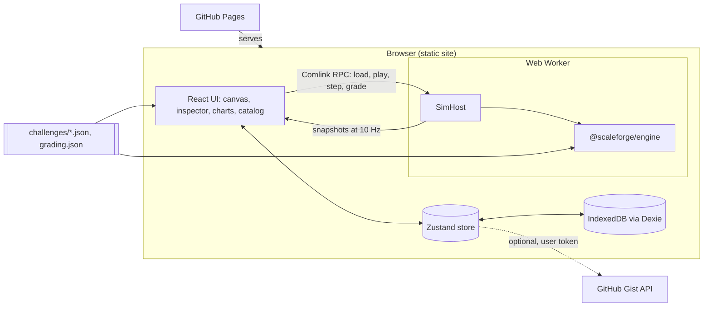
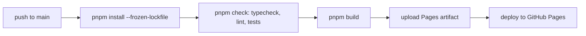
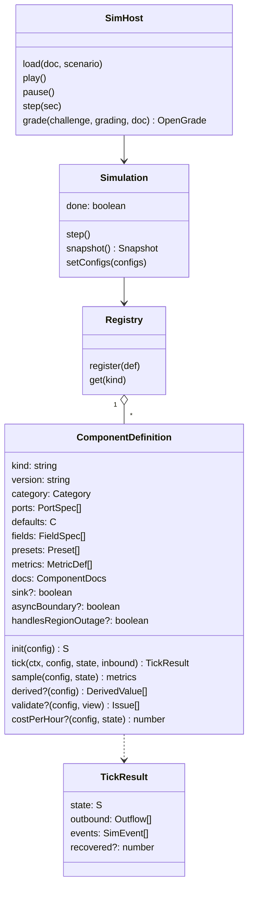
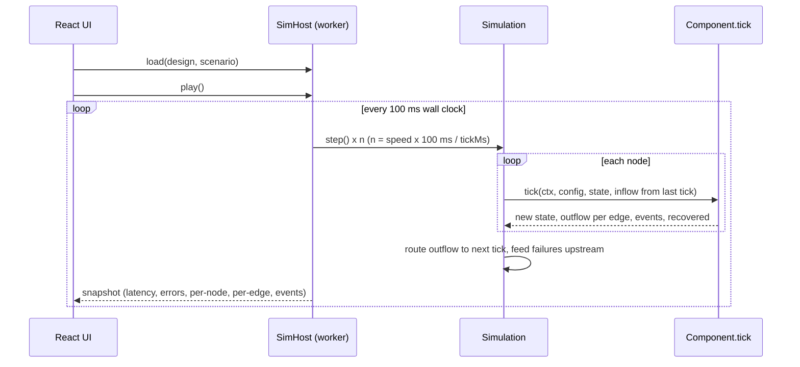
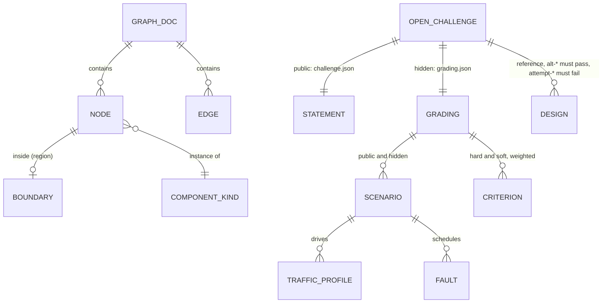

## Overview

ScaleForge is a backend architecture simulator that runs entirely in the browser. You drag components onto a canvas, connect them, choose a traffic profile, a duration and a seed, schedule faults, and press play. Nodes change colour with utilization, edges thicken with throughput, queues show their fill, and an event timeline lines up causes ("credits exhausted", "rebalance started") with effects on the latency and error charts.

It is built for mid to senior backend engineers who want intuition for failure modes that are expensive to reproduce on real infrastructure: consumer lag behind a hot partition, a database melting after a cache flush, a retry storm turning a blip into an outage, a region disappearing. On top of the free-form workspace there are focused labs (Bloom filters, eviction policies, hashing, replication and failover, quorums, retries and metastable failure) and two kinds of challenges: guided exercises and open-ended engineering problems graded against hidden scenarios.

It is complete and live: the [demo](https://scaleforge.shithanshu.com/) is deployed from the [repository](https://github.com/SHITHANSHU/scaleforge) by a GitHub Actions workflow that runs typecheck, lint and the test suite before every build.

<Callout type="note" title="Honest limits">
ScaleForge is a teaching model, not a production predictor. It simulates behaviour, not software, and every number it ships is labelled approximate with a source. The limits are listed in [Learnings](#learnings) and [Planned but Restricted](#planned-but-restricted).
</Callout>

## Problem Statement

### The problem

System design is taught and interviewed with boxes and arrows. On a whiteboard the boxes never fail, the arrows never saturate, and nobody checks whether a design survives a retry storm, a cold cache, or the loss of a region. The parts of distributed systems that actually hurt are dynamic: queues that grow when input exceeds capacity, burst credits that run out after twenty minutes, replicas that lag, retries that multiply load exactly when the system is weakest.

### Why it matters

Engineers learn these behaviours mostly by living through incidents. That is slow, expensive and unrepeatable. A model that is honest about what it leaves out can make the same failure modes cheap, repeatable and comparable: run design A and design B against the same seeded traffic and see which one breaks first and why.

### Who has it

Backend engineers moving into senior and staff roles, people preparing for system design interviews, and anyone who wants to test an architectural intuition ("will a cache in front of this database survive a flush at peak?") without provisioning anything.

### Limits of existing options

- **Diagramming tools** draw architecture but do not execute it.
- **Real clusters and load generators** are faithful but costly, slow to set up, and cannot easily replay the same failure twice.
- **Queueing theory** is exact for single components but awkward for a 20-node graph with retries, caches and asynchronous boundaries.
- **Interview prep material** describes failure modes in prose; you cannot poke it.

### Goals and requirements

| Goal | Requirement |
|---|---|
| Realistic enough for senior engineers | Model the behaviours that change a design decision: saturation, queueing, lag, credit exhaustion, eviction, replication lag, retries, duplicates |
| Fast | A 50-node graph runs much faster than real time on a laptop; the UI never blocks |
| Reproducible | Same design, scenario and seed give the same result, every time |
| Gradable | Challenges judged automatically, including against scenarios the player cannot see |
| Transparent | Every throughput, latency and capacity figure visible, editable and sourced |
| Zero infrastructure | Static hosting, no accounts, no backend |
| Extensible | Adding a component is one folder; adding a challenge needs no code |

## Proposed Solution

### Approach

Three principles from the plan shaped every decision:

1. **Simulate behaviour, not software.** Model rates, queues, limits and failure rules. Never run real Kafka, Redis or RabbitMQ.
2. **Run real algorithms where they are cheap.** Bloom filters, LRU and LFU eviction, consistent and rendezvous hashing, and token buckets run for real.
3. **Assumptions are data.** Every figure lives in an editable preset, labelled approximate, with a source.

The core is a fixed-step **flow** simulator. Each tick, every node consumes the flow that arrived on the previous tick, decides how much it can process, queues or drops the rest, and emits outbound flow per edge. Flow carries a count, a mean latency, a read fraction and a duplicate fraction, never per-request identity. That is what makes it fast enough to run large graphs at hundreds of times real time, and it is also its main simplification.

### How it answers the requirements

- **Realism:** each component models the knobs engineers actually tune and the failure modes they actually hit, and failure feeds back upstream so retries and timeouts behave like the real thing.
- **Speed and responsiveness:** the engine is dependency-free TypeScript in a Web Worker, posting snapshots at 10 Hz while the canvas stays interactive.
- **Reproducibility:** all randomness comes from a seeded generator passed in by the engine; components may not call `Math.random` or read the clock.
- **Grading:** deterministic simulation over public and hidden scenarios with author-defined criteria, run in a worker.
- **Transparency:** presets carry sources; the inspector shows derived values live (Bloom filter bits and hash count from n and p, useful consumers from partitions); in-app docs are generated from component metadata.
- **Zero infrastructure:** IndexedDB for saves, the URL hash for sharing, optional GitHub Gists with the user's own token, static hosting on GitHub Pages.

### Key features

- Canvas editor with palette, inspector, quick-add, grouping into region boundaries, undo and redo, and keyboard shortcuts.
- Scenario editor: traffic profiles (constant, ramp, step, spike, diurnal, soak, pulses), key distributions, duration, seed and a fault timeline.
- 19 component kinds across traffic, network, compute, cache, messaging and data.
- Live overlays on the canvas plus charts for throughput, error rate, p50/p95/p99, retries, duplicates and cost per hour.
- 8 labs for single concepts, 7 guided exercises, 10 open-ended challenges with a catalog, filters and progress.
- Sharing by link, `.sdsim.json` export, Gist, and a read-only `?embed=1` view.

### Technical decisions and trade-offs

| Decision | Why | Trade-off | Alternative considered |
|---|---|---|---|
| Flow model, not discrete events | Hundreds of times real time on 50-node graphs | Per-request behaviour must be analytic or sampled; tail latency understated | Discrete-event simulation of every message: accurate but slow |
| One tick of delay per edge | Cycles work and node order never matters | Adds latency not counted in the latency sum | Topological evaluation: breaks on cycles |
| Open-loop load only | Simple, and shows overload clearly | No think time or closed-loop users | Closed-loop mode: on the roadmap |
| Engine has zero dependencies, lint-enforced | Portable to Node, a CLI or tests unchanged | Everything hand-rolled | Sharing utilities with the UI |
| Simulation in a Web Worker via Comlink | CPU-bound work off the UI thread | Typed RPC boundary to maintain | Main thread with `requestIdleCallback` |
| Inspector rendered from component metadata | New component gets UI and docs for free | Less bespoke UI per component | Hand-built panels |
| Docs in the app, not a separate site | Docs cannot drift from the registry | No long-form docs site | Astro Starlight or VitePress (planned, then dropped) |
| Prices as a gameplay constraint | Stops "just add 50 instances" | Approximate, sometimes underpriced | Live AWS pricing: needs updates and a backend |
| No backend at all | Free hosting, no accounts, privacy | No cross-device sync; Gist needs a token | Small serverless store |

## Architecture

### High-level design

The diagram shows the three runtime pieces and the data that connects them. Designs, scenarios and challenges are plain JSON; the engine never imports UI code; the worker is the only place the engine runs in the browser.



Deployment is a static build: GitHub Actions installs with a frozen lockfile, runs `pnpm check` (typecheck, lint, tests including challenge lint and golden runs), builds `apps/web/dist`, and publishes it to GitHub Pages.



### Low-level design

**Component contract.** Every component is a folder exporting one `ComponentDefinition`. The registry validates its shape at registration; the UI renders the inspector from `fields`, the docs page from `docs`, and charts from `metrics`. `defineComponent` is an identity helper that gives contributors type inference on config and state.



**The tick loop.** One `Simulation.step()` advances simulated time by one tick (10 ms by default). The worker turns wall-clock time into a number of steps and gives up early if a batch would take more than 80% of its 100 ms budget, so a heavy graph slows down instead of freezing the worker.



**Failure feedback.** Drops, kills and client timeouts are reported to the edges that fed the failing node and flow upstream one tick later, attributed proportionally to inbound edges. Asynchronous boundaries (Kafka, RabbitMQ, Debezium) stop the propagation, which is exactly how a queue decouples producers from a failing consumer. A component that handles failure itself (retry, requeue, cache fall-back) reports it as `recovered`, so it does not count as a user-visible error.

**Data model.** A design is a graph document; a scenario is traffic plus faults plus a seed; an open challenge separates the public statement from the grading data the player never sees.



**Grading.** For each scenario the grader runs the design deterministically and evaluates criteria over the judged window using the worst case (max for "less than", min for "greater than"), so a transient spike fails. Hard criteria gate passing; soft criteria give partial credit; budgets use peak spend; unknown metrics never pass; the score is capped below the pass mark while any must-have fails. A scenario is invalid if under 40% of offered traffic completes end to end.

**Persistence and sharing.** Designs autosave to IndexedDB through Dexie. Links compress the design with lz-string into the URL hash. Every saved file carries a schema version and imports are validated with Zod.

## Implementation

### Technology stack

TypeScript (strict) in a pnpm workspace; Vite; React 18; React Flow for the canvas; Zustand with Immer for state and undo; Comlink for the worker bridge; uPlot for live charts; Zod for validation; Dexie for IndexedDB; lz-string for share links; Tailwind CSS v4; Vitest for tests.

### Repository layout

| Path | Contents |
|---|---|
| `packages/engine` | `core/` (simulation, graph, registry, RNG, scenario, flow, contract, challenge grading), `components/` (one folder each, plus a `_template`), `algorithms/` (Bloom, LRU, LFU, consistent hash, rendezvous, token bucket), `metrics/`, `tests/` |
| `apps/web` | Canvas, panels, screens (home, challenges, labs, presets, docs), `sim/worker.ts`, state, persistence |
| `challenges/guided`, `challenges/open` | Challenge folders: statement, grading, write-up, reference and alternative designs |
| `tools/challenge-lint`, `tools/open-challenges` | CI checks and authoring helpers |
| `docs/` | `decisions.md` (24 entries), `challenge-authoring.md`, `research/` (four topic files and a synthesis) |

### Important implementation decisions

- **Engine purity is enforced by lint,** not convention: no DOM, no React, no `Math.random`, no wall clock. A component that broke determinism would silently break grading.
- **Components run real algorithms only where they change decisions.** The Redis hit ratio in the engine is analytic (Zipf coverage × policy factor × TTL factor × warmth); real LRU and LFU run in the eviction lab. The Bloom filter runs for real on sampled keys, scaled down above 4M bits.
- **Composition for derived components.** The autoscaling group imports the EC2 model rather than re-implementing it, as the pattern for future derived components.
- **Kafka topic plus one consumer group is one node,** with per-partition lag, key skew, retention loss and rebalance pauses, but no replication internals. RabbitMQ queues are aggregated into one backlog; the routing lab does real key matching.
- **Deterministic seeds everywhere.**

```ts
// title: seeded RNG, the whole idea (illustrative)
export function makeRng(seed: number) {
  let a = seed >>> 0;
  return () => {              // mulberry32-style
    a = (a + 0x6d2b79f5) >>> 0;
    let t = Math.imul(a ^ (a >>> 15), 1 | a);
    t ^= t + Math.imul(t ^ (t >>> 7), 61 | t);
    return ((t ^ (t >>> 14)) >>> 0) / 4294967296;
  };
}
```

### Adding a component

A contributor copies `components/_template`, fills in defaults, `fields` (which become the inspector), presets with sources, metrics, docs, and the `init`, `tick` and `sample` functions, then registers it with one line. The contract checker validates the shape; the docs page and inspector appear automatically.

```ts
// title: a component, reduced to its shape (illustrative)
export default defineComponent({
  kind: "rate-limiter", version: "1.0.0", category: "network",
  ports: [{ id: "in", direction: "in" }, { id: "out", direction: "out" }],
  defaults: { ratePerSec: 1000, burst: 2000 },
  fields: [{ key: "ratePerSec", type: "number", label: "Rate", unit: "req/s" }],
  presets: [], metrics: [{ key: "rejected", label: "Rejected/s" }], docs: { /* … */ },
  init: (cfg) => ({ tokens: cfg.burst }),
  tick: (ctx, cfg, state, inbound) => { /* refill, admit, reject */ },
  sample: (cfg, state) => ({ tokens: state.tokens }),
});
```

### Testing strategy

- **Engine unit tests** against known math: queue latency against utilization, Bloom false-positive rate against the formula, lag growth as input minus capacity over time.
- **Resilience tests** for failure feedback, retries and timeouts, `recovered`, duplicates, regions and asynchronous boundaries.
- **Golden runs:** fixed design, scenario and seed produce a metric snapshot; any engine change that moves it must be explained. The same file holds a 50-node performance check that asserts at least 20× real time and logs the measured rate.
- **Challenge lint:** every challenge validates, starters fail, references and `alt-*` designs pass, `attempt-*` designs fail, statements do not leak solutions, results reproduce.
- **Saved-design compatibility:** old fixtures still load through migrations.
- **CI gate:** the Pages workflow runs `pnpm check` before every build, so nothing deploys with a failing test.

## Issues & Fixes

### An empty design scored perfectly

**Problem.** Early on, a design that connected nothing passed criteria about errors and latency.

**Root cause.** Flow leaving an unconnected output port simply completed. With no downstream components there was nothing to fail and nothing to add latency.

**Fix.** A dead end is now an error (decision 16). Flow leaving an unconnected output only completes a request if the port is hidden or terminal, or the component is a declared `sink` (service endpoints, brokers). Everything else is dropped and counted.

**Lesson.** Every grading hole is cheaper to close with a must-fail design checked in CI than with a rule in prose. The "do nothing" design is the first attempt to add.

### Parked work looked healthy

**Problem.** Designs that queued or discarded most traffic could still satisfy latency and error criteria on the small fraction that did complete.

**Root cause.** Criteria measured the requests that finished, not the ones that did not.

**Fix.** Grading guards (decision 24): a scenario is invalid if under 40% of offered traffic completes end to end. Locked nodes are compared on their full effective configuration, cross-region replicas pay at least the scenario's round trip, and unknown criterion scenarios are reported.

**Lesson.** A metric over survivors is survivorship bias; always grade against what was offered.

### Transient spikes were averaged away

**Problem.** A design that collapsed for a few seconds and recovered could pass on averages.

**Fix.** Criteria use the worst case over the judged window (decision 13): the maximum for "less than" criteria, the minimum for "greater than". A transient spike fails, as it would page someone in production.

### Async failover lost the wrong data

**Problem.** The first replicated-database model counted data loss on asynchronous promotion as the replica's apply backlog.

**Root cause.** Those are different quantities. Writes the replica received but has not applied are not lost; it replays them before promotion. Only the log the primary never shipped is lost.

**Fix.** Loss is now `shipLagSec × write rate`, and a lagging replica instead takes longer to promote (decision 19).

**Lesson.** In a flow model, naming the right quantity is the whole model. The wrong one gives confident, wrong answers.

### Promotion flapped under a network partition

**Problem.** After a failover during a partition, the old primary could come back into the role on the next tick.

**Root cause.** The partition fault isolated "the primary" as a role, so after promotion it isolated the new primary instead.

**Fix.** Partitions isolate a node, not a role (decision 20): after promotion the partition keeps isolating the old primary.

### Retry storms could not happen

**Problem.** Without failure information flowing backwards, clients could not retry, so the most important failure amplifier in distributed systems was missing.

**Fix.** Failure feedback (decision 15): drops, kills and timeouts are reported to the feeding edges one tick later, async boundaries stop propagation, and components that recover failures report `recovered`. Retries carry their accumulated backoff wait into latency. Duplicates created by timeout-then-retry ride along as `dupFraction` (decision 18), and an idempotency store absorbs them within its window.

**Lesson.** Exactly-once is never claimed: only effectively-once at a boundary that deduplicates.

### CI typecheck failed on the first deploy

**Problem.** Right after the Pages workflow was added, the CI typecheck step failed, which blocked the deploy because the build job runs `pnpm check` first.

**Root cause.** Node's type definitions were not declared as a dev dependency, so the clean CI install did not have them.

**Fix.** Added `@types/node` explicitly (the third commit in the repository).

**Lesson.** A frozen-lockfile install in CI is the first honest test of declared dependencies.

## Learnings

### Technical learnings

- **An ADR log pays for itself immediately.** Writing the limitation next to the decision (decision 23 on tail latency is the clearest case) made it obvious which claims the UI could and could not make.
- **Determinism is a feature, not a testing convenience.** Seeds turned "it broke once" into a shareable link and made automatic grading possible at all.
- **Flow models are easy to exploit.** Most of the late engine work was closing loopholes where a bad design looked good, and each one became a must-fail fixture.
- **Metadata-driven UI scales.** Rendering inspectors and docs from the component definition kept 19 components consistent with no per-component UI code.

### What I would do differently

- Write the must-fail designs before the grading rules, not after discovering exploits.
- Add the request-trace view early. A learner needs to see *why* a design lost, not only *that* it did.
- Keep test counts in one generated place. The plan quotes 245, a static grep finds about 117 test declarations (parametrized cases expand at runtime), and I only trust a number from an actual run.

### Known limitations

- Latency percentiles are over volume-weighted per-tick means, so real tail latency is understated (decision 23).
- Open-loop load only: no closed-loop users or think time (decision 3).
- One tick of edge delay adds latency not in the latency sum (decision 2).
- Presets and prices are approximate; some components are underpriced (decision 22).
- No per-request identity: failures are attributed proportionally, not traced.

## Future Improvements

1. **Request-trace view and run comparison:** follow one sampled request through the graph, and overlay two runs on the same charts.
2. **"Find my ceiling":** ramp until an SLO breaks and report the max sustainable rate and the first component to saturate.
3. **Closed-loop load** with virtual users and think time.
4. **New components:** columnar OLAP, object storage with prefix throttling, time-series, service mesh, lock and lease service.
5. **New playgrounds:** leader election with fencing tokens, gossip, vector clocks, saga and outbox.
6. **Playwright end-to-end suite** (build, run, share, reload from link) and a JSON editor for presets and challenges.

## Planned but Restricted

| Scope | State | What restricts it |
|---|---|---|
| Request trace, run comparison, find-my-ceiling | Planned | Product work after the engine stabilized; not built |
| Closed-loop load | Planned | Engine supports open-loop only by design (decision 3) |
| Columnar OLAP, object storage, time-series, service mesh, lock service | Planned | Need research-backed models first |
| Separate CockroachDB, MongoDB, ScyllaDB, DynamoDB nodes | Not planned | Covered by the generic `quorum-kv` and `replicated-db` models |
| Leader election, gossip, vector clocks, saga playgrounds | Planned | Not built |
| GitHub Gist save and load | Built, unverified | Never tested against the live Gist API |
| Playwright end-to-end tests | Planned | Unit, golden and challenge tests exist; no browser E2E suite |
| Full editing on mobile | Out of scope | Read-only view only; narrow-screen drawers and live-region announcements are open accessibility items |
| Realistic per-component pricing | Restricted | Prices are a gameplay constraint; live cloud pricing would need a backend and regular updates |
| Production capacity prediction | Out of scope | Teaching models; vendor timings are not asserted |
| Licence file | Not added yet | Needed before outside contributions |
